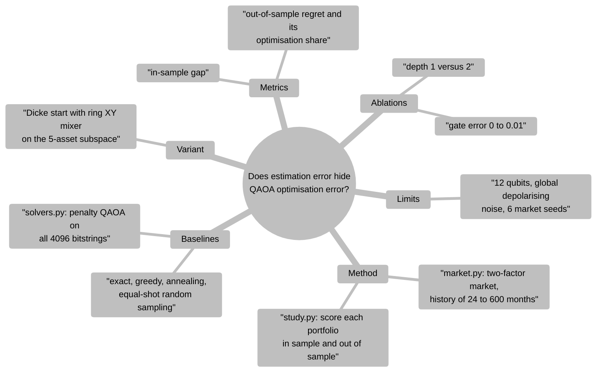
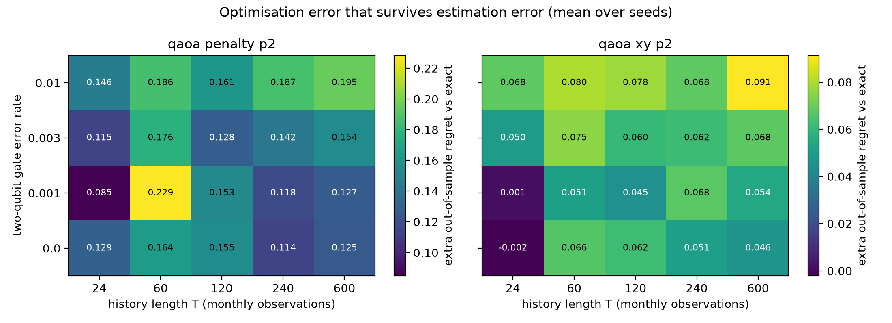
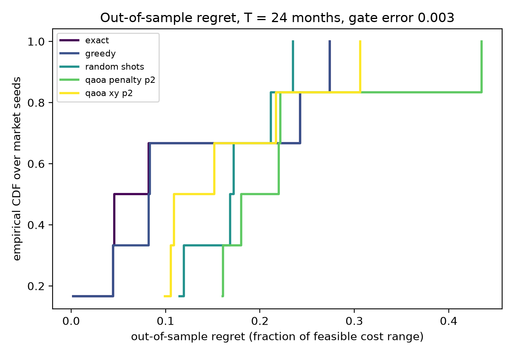
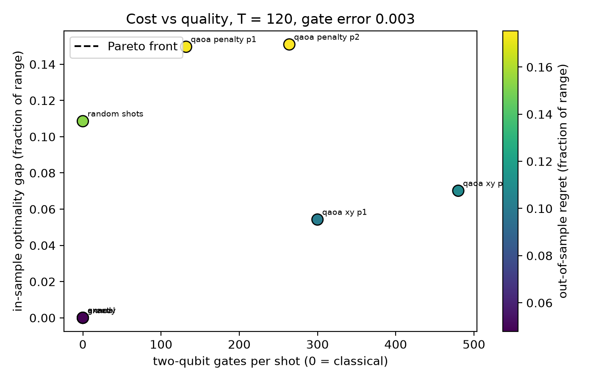

# Estimation-error floor for Quantum Approximate Optimization Algorithm portfolio selection

[](LICENSE)

[](https://github.com/pradeepdegalaroyal/portfolio-qaoa-estimation-error-floor/actions/workflows/ci.yml)

**Abstract.** Quantum Approximate Optimization Algorithm (QAOA) papers score a solution against the optimum of the instance they are given, but in portfolio selection the instance is an estimate from a finite return history. This simulation study picks 5 of 12 assets (mean-variance cost) and scores solvers by out-of-sample regret under the true market moments, comparing penalty QAOA, a Dicke-state XY-mixer QAOA, and classical baselines under a gate-count noise model. QAOA does not match the exact solver here, but the share of total regret caused by optimisation error rises from 0.301 at 24 months of history to 0.889 at 600 months for the XY circuit.

## Motivation

In finance, the mean and covariance fed to an optimiser come from a limited history. The exact optimum of that estimate is a noisy proxy, so a sub-optimal solver may lose little real value. This matters when asking whether noisy variational circuits are good enough for applied optimisation.

## Research gap

Blekos et al., 2024 (10.1016/j.physrep.2024.03.002) review QAOA variants. Wołk et al., 2027 (10.1016/j.ins.2026.124187) show constrained mixers need extra gates, which costs noise robustness. Alzboun and Abed-alguni, 2027 (10.1016/j.ins.2026.124009) ask why variational circuits often fail to beat classical methods. None scores solutions against the true out-of-sample objective when the inputs are estimated. Related-work table: [`docs/RESEARCH_GAP.md`](docs/RESEARCH_GAP.md); design: [`docs/METHOD.md`](docs/METHOD.md).

## What is new here

- Solutions are scored out of sample (true moments), not only against the estimated optimum.
- The share of regret due to optimisation error is measured as a function of history length.
- Penalty and constrained-mixer QAOA are compared at equal shots (25) and a gate-count noise model, next to exact, greedy, annealing and equal-shot random sampling.

## Method



Legend: QAOA = Quantum Approximate Optimization Algorithm; XY = excitation-preserving two-qubit hopping mixer; Dicke = equal superposition of all 5-asset selections.

Task: choose 5 of 12 assets with equal weights, minimising 5·w'Σw − μ'w (covariance Σ, mean μ). Solvers see estimates from T monthly observations; the true moments score the result. Both QAOA variants are trained noiselessly and sampled with 25 shots under λ = 1 − (1 − p)^G (G = controlled-NOT (CNOT) gates per shot, p = two-qubit gate error). Metrics are fractions of the feasible cost range. Details: [`docs/METHOD.md`](docs/METHOD.md).

## Results

All numbers are from `results/` (12 qubits, 6 market seeds, 5 shot draws each, mean ± standard deviation over seeds). Noise reference level: two-qubit gate error 0.003. "Regret" means out-of-sample regret; "extra regret" is the paired difference to the exact in-sample optimum.

**Claim 1. The exact in-sample optimum is itself a noisy answer, and optimisation error matters more as history grows.** Regret of the exact solver falls from 0.115 ± 0.114 (24 months) to 0.008 ± 0.014 (600 months). The share of regret due to optimisation error for the XY circuit at depth 2 rises from 0.301 to 0.889 (`results/optimisation_share.csv`).

| History T (months) | exact regret | penalty depth 2 regret | XY depth 2 regret | XY depth 2 extra regret | random-shots regret |
|---|---|---|---|---|---|
| 24 | 0.115 ± 0.114 | 0.230 ± 0.104 | 0.165 ± 0.082 | 0.050 ± 0.056 | 0.170 ± 0.048 |
| 120 | 0.048 ± 0.074 | 0.175 ± 0.047 | 0.108 ± 0.048 | 0.060 ± 0.084 | 0.153 ± 0.064 |
| 600 | 0.008 ± 0.014 | 0.163 ± 0.071 | 0.076 ± 0.029 | 0.068 ± 0.033 | 0.104 ± 0.047 |



*Takeaway: extra out-of-sample regret of noisy QAOA is large almost everywhere; only the XY circuit at low gate error and short history comes close to zero.* Caveat: the seed spread is as large as many of the differences, with only 6 markets.

**Claim 2. At 25 shots the penalty circuit is no better than random feasible sampling; the constrained circuit is.** At T = 24, the in-sample gap is 0.164 ± 0.063 (penalty, depth 2) and 0.075 ± 0.037 (XY, depth 2) versus 0.116 ± 0.032 for random sampling.



*Takeaway: at 24 months the exact solver has a wide regret distribution too, and the XY circuit overlaps it.* Caveat: 6 market seeds per curve; training uses only 120 optimiser iterations.

**Claim 3. Classical solvers dominate on cost and quality; extra gates buy quality only inside the constrained circuit.** At T = 120 and gate error 0.003 (`results/pareto_points.csv`) the XY circuits use 300 (depth 1) and 480 (depth 2) CNOT gates per shot with in-sample gaps 0.054 and 0.070, the penalty circuits use 132 and 264 gates with gaps 0.150 and 0.151, and the classical solvers reach 0.000 with none.



*Takeaway: the Pareto front is the classical corner (the dashed line collapses to that point); QAOA points sit above it.* Caveat: the XY gate count includes an assumed Dicke-preparation cost of 2·n·k gates.

## Discussion

The stated hypothesis (extra out-of-sample regret at most 0.02 at 24 months for gate error up to 0.003) is **refuted**: XY depth 2 gives 0.050 ± 0.056 and penalty depth 2 gives 0.115 ± 0.093 at 0.003. Only the XY circuit at gate error 0 or 0.001 reaches about zero extra regret at 24 months (−0.002 and 0.001 at depth 2), within large seed noise. The second part, that the optimisation share shrinks with shorter history, is supported (0.301 at 24 versus 0.889 at 600 months). This mostly reflects the exact solver's own regret shrinking, not QAOA improving: the extra regret is roughly flat in T. Negative results: penalty QAOA is no better than random feasible sampling, depth 2 did not help noticeably, and greedy and annealing match the exact optimum almost everywhere.

## Limitations

- 12 qubits and 6 market seeds; standard deviations across seeds are large.
- Noise is a global depolarising approximation by gate count, not a device model; the Dicke gate count is an assumption.
- Parameters are trained noiselessly with a small optimiser budget; better training could change the QAOA ranking.
- Synthetic Gaussian returns, equal weights, one risk aversion. No quantum advantage is claimed or observed.

## Future work

Real return data and weight optimisation, noisy-trajectory simulation or hardware runs of the 5-of-12 instance, shrinkage covariance estimators (which lower the floor), and larger n with matrix-product-state simulation.

## Reproducibility

```bash
pip install -r requirements.txt
pytest -q
python experiments/run_all.py --quick   # smoke run, writes results_quick/ and figures_quick/
python experiments/run_all.py           # 867.8 s in the recorded run, writes results/ and figures/
```

Hardware: Windows 11 laptop, CPU only (NumPy). Pinned versions are in `requirements.txt`.

## Project structure

```
src/pqfloor/market.py    market model and objective
src/pqfloor/solvers.py   baselines, QAOA simulators, gate counts, noise
src/pqfloor/study.py     one study cell
experiments/             run_all.py, analyse.py
results/  figures/  docs/  tests/
```

## Related work by the author

[satellite-scheduling-qaoa-cvar-noise](https://github.com/pradeepdegalaroyal/satellite-scheduling-qaoa-cvar-noise) (conditional value at risk training of QAOA under noise) and [xy-mixer-vs-penalty-qaoa-noise-crossover](https://github.com/pradeepdegalaroyal/xy-mixer-vs-penalty-qaoa-noise-crossover) (gate overhead of XY mixers versus penalties). This project adds the input-estimation view on a finance task.

## Citation

```bibtex
@software{degala_portfolio_qaoa_2026,
  author  = {Degala, Chenchupradeep},
  title   = {Estimation-error floor for Quantum Approximate Optimization Algorithm portfolio selection},
  year    = {2026},
  version = {0.1.0},
  url     = {https://github.com/pradeepdegalaroyal/portfolio-qaoa-estimation-error-floor},
  license = {MIT}
}
```

MIT license (`LICENSE`). See also `CITATION.cff`.
